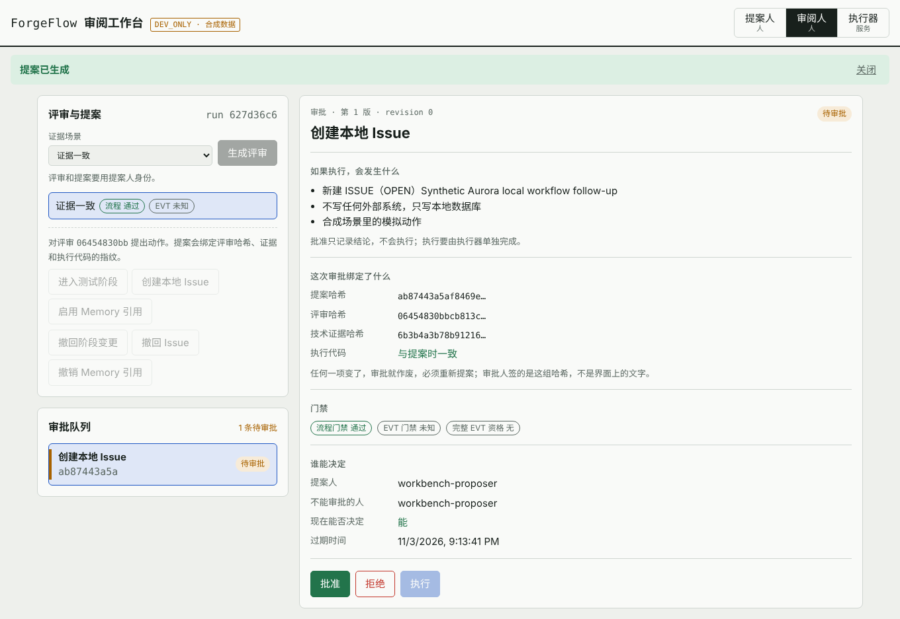
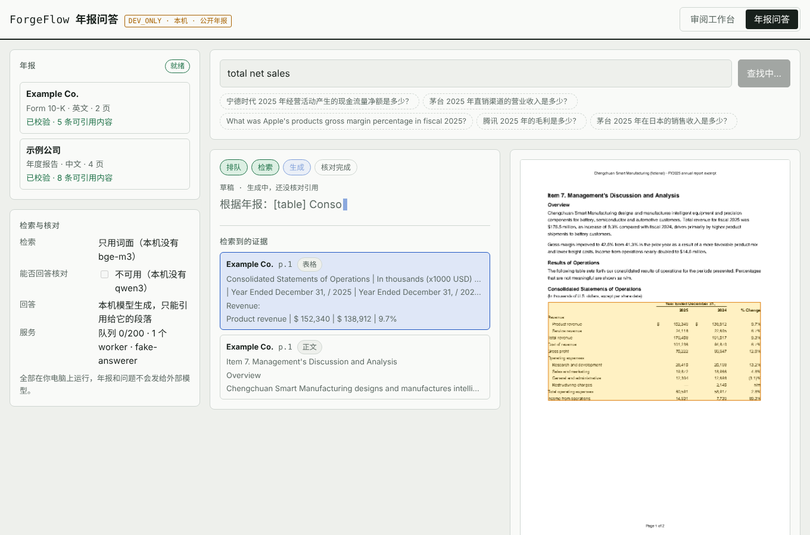
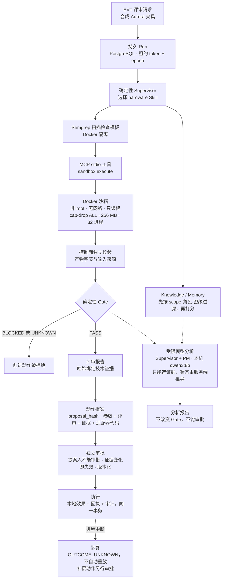

# ForgeFlow

**English summary.** ForgeFlow is a local, evidence-first prototype of the control plane an enterprise agent needs before it is allowed to act: durable runs with fenced leases, MCP tool calls into a locked-down Docker sandbox, permission filtering before retrieval, deterministic stage-gate rules, bounded local-LLM analysis whose output is data rather than authority, approvals bound to evidence hashes, and crash-safe action receipts. The scenario is a synthetic hardware EVT readiness review. Everything runs on one machine against synthetic data; it is not a production system and is not connected to real hardware, trackers or office tools. The rest of this page is in Chinese.

## 这是什么

ForgeFlow 是一个在本机运行的企业 Agent 运行时原型。演示场景是合成的硬件研发评审：项目 Aurora 能否从 Prototype 进入 EVT。它要回答的问题是：Agent 在企业里真正执行一个动作之前，系统必须保证什么。

- **运行可恢复。** 每次运行持久化在 PostgreSQL；worker 用带 token 和 epoch 的租约认领，过期的写入返回 `STALE_LEASE`；中断后无法确认结果的动作记为 `OUTCOME_UNKNOWN`，不会自动重放。
- **工具受隔离。** 检查程序先过 Semgrep 扫描，再通过官方 MCP Python SDK 的 stdio 工具 `sandbox.execute`，在非 root、无网络、只读根文件系统的 Docker 容器里运行。
- **检索先授权。** Knowledge 与 Memory 分开存放，都在打分之前按 scope、角色和密级过滤。
- **判定是确定性的。** Gate 规则给出 PASS、BLOCKED 或 UNKNOWN；证据过期、检查失败、产物校验不通过，都得不到 PASS。
- **模型受约束。** 本机 qwen3:8b 只读已有证据，只能从服务端给出的证据目录里选择；完成状态由服务端推导，模型不能改 Gate，也不能审批。
- **动作必须绑定审批。** 提案哈希绑定动作参数、评审报告、技术证据和执行适配器代码，批准和执行时各校验一次；提案人不能审批；效果、回执和审计在同一事务里写入。

所有研发数据都是合成的。没有生产部署，没有真实硬件认证，也没有接入 GitHub、Jira、飞书等外部系统。

## 当前状态（2026-10-10）

| 方面 | 状态 | 依据 |
|---|---|---|
| 默认测试（不需要 Docker、PostgreSQL、模型） | 1014 项：1001 通过，13 项实机测试默认跳过 | `pytest -q` |
| 与系统时钟无关 | 在 2026-10-09 的版本上，把系统时钟伪造为 2026-11-06、2027-06-01 各复跑一次，结果不变（到期提醒除外，见下文）；之后的改动没有重做这项验证 | [审阅与修复记录](docs/19-review-and-fix-record.md) |
| 冻结证据可重放 | S2C 实验的 26 个用例用锚定提交自己的代码重放 | `tests/test_frozen_replay_at_anchor.py` |
| 实机链路（Docker + PostgreSQL + MCP） | 2026-10-10 在 PostgreSQL 库副本上用当前代码重跑：真实 MCP 与 Docker 检查，本机 qwen3:8b 的 4 次分析放在同一个父 run 上，6 个动作经人工逐个批准后执行并补偿，提交前被杀后恢复，UNKNOWN 与超时被拒；失败和意外一并留档 | [`deliveries/2026-10-10/`](deliveries/2026-10-10/DELIVERY.md) |
| 本机模型分析（Ollama qwen3:8b） | 5 个真实模型场景各跑 1 次，共 20 次模型调用 | `deliveries/2026-10-06/s2c-fixes/evidence/` |
| 冻结评测 | 13 项验收：修正评分器的一个记录展开错误后，用同一批原始调用链重评为 13/13，没有新增模型调用；评测范围只是证据选择和服务端状态推导 | `deliveries/2026-10-06/s2c-fixes/evidence/regrade-01/summary.json` |
| 检索 | 只有词法检索：冻结评测集 37 个查询，macro Recall@5 = 78.38%（找到 29 个）；同义词和跨语言查询（各 4 个）全部漏检 | `preparation/s2/evaluation/RESULTS.md` |
| 多角色 | Supervisor 与 PM 使用模型；Architect、Android、SRE 是确定性检查器；Android 构建与设备测试未运行 | `analysis_workflow.py`、`domain_checks.py`、`sre_ops.py` |
| 身份 | 本地开发身份，静态 token；审批人身份来自测试身份文件，没有独立发放 | `api.py`、`fabric_runtime.py` |
| 外部系统 | Issue、阶段变更、Memory 只写本地数据库 | `fabric_store.py` |

各阶段的测试数量口径不同，不能相加。

## 审阅工作台（React + FastAPI）

审批流程原来只能用命令行和 HTTP 调用走。审阅工作台把它做成一个页面：提案人生成评审、提出动作；审阅人看清这个动作会做什么、绑定了哪些哈希、门禁状态、谁不能审批，然后批准或拒绝；执行器执行已批准的动作并写入回执。页面上可以切换三种身份，各自能做什么完全由服务端决定，页面只负责把服务端的结论讲清楚。

```bash
bash scripts/workbench.sh      # 需要 Python 3.12 和 Node；打开 http://127.0.0.1:8780/workbench/
```



- **前端**：`web/`，React 18 + TypeScript + Vite，没有 UI 库。每次操作后从服务端重新读取状态，不在前端推断；每次写请求带新的 Idempotency-Key；审批时提交审阅人看到的 `proposal_hash` 和 `expected_revision`，参数变了或别人先决定了，服务端返回 409，页面给出原因和下一步。
- **后端新增**（只读）：`GET /fabric/reviews`、`GET /fabric/approvals`（队列）、`GET /fabric/approvals/{id}/explain`（审批人需要知道的全部，原来只有命令行能看）。权限、范围和记录完整性检查与原有接口相同。
- **本地服务**：`python -m forgeflow.workbench` 用 Fabric 测试同样的离线方式，从封存的 M01 归档派生一个 SQLite 数据库（重新绑定范围和文档引用、重建所有派生哈希，不重新执行检查程序），并提供三个固定的开发身份。仅绑定 127.0.0.1，DEV_ONLY。
- **测试**：`tests/test_workbench.py`（列表、explain、未认证 401、越权范围 404、提案人不能审批、人不能执行、两个审阅人同时决定时后者 409）；`web/src/labels.test.ts`（队列状态和错误说明）。

## 混合检索（词法 + 向量，RRF 融合）

`forgeflow.retrieval.RankedKnowledgeService` 只替换知识检索的排序这一步：词法（原样）、向量（本机 Ollama 的 `bge-m3`，余弦相似度加固定下限）或两者用 RRF 融合。权限顺序不变：Store 先按角色、密级、scope 过滤，再排序，再逐条重新授权引用，所以嵌入模型只看得到调用者有权读的内容（测试逐题核对）。

在同一冻结题集上（47 题，参数和判断规则跑之前已登记）：

| | 词法 | 向量 | 混合 |
|---|---|---|---|
| 内容正例 Recall@5 | 73.33% | 86.67% | 93.33% |
| 同义 / 跨中英文 | 0/4 / 0/4 | 3/4 / 3/4 | 3/4 / 3/4 |
| 越权泄漏 | 0/47 | 0/47 | 0/47 |
| 时延中位数 | 2.1 ms | 137.8 ms | 140.6 ms |

向量单独会漏掉纯 ID 查询，融合后补回；剩下的漏检和“无答案”问题说明，能不能回答不能靠调相似度阈值决定。细节、漏检和限制见 [preparation/s2/evaluation/hybrid/RESULTS.md](preparation/s2/evaluation/hybrid/RESULTS.md)，复现用 `bash scripts/mac_retrieval_eval.sh`（需要本机 Ollama）。

## 可回答性判断（检索之后：结果里有没有真正回答问题的那条）

`forgeflow.answerability` 接在混合检索之后：S1 的权限和引用检查跑完，才把返回给这个调用者的结果交给本机 `qwen3:8b`（Ollama，关闭思考，温度 0，严格 JSON），逐条判断“是否回答了问题”并要求引用原文，引文不逐字出现在那一条里就不算。它只能删、不能加或改；一条都不剩就明确返回“知识库里没有答案”；模型输出不合格或连接失败就返回空并标 `GATE_ERROR`，不冒充“没有答案”。纯 ID 查询（如 `evt-boot`）不调用模型。测试用假模型逐条核对：引文核对、不会多出条目、空结果、判断步骤只看得到调用者有权读的内容、只连本机地址。

新写了 32 题留出集（与代码同一作者，跑之前冻结，判断规则先登记）：

| | 混合 | 混合 + 判断 |
|---|---|---|
| 有答案题 gold 找回（18 题） | 18/18 | 18/18 |
| 无答案题正确为空（12 题，都贴近真实文档的话题） | 0/12 | 7/12 |
| 越权泄漏 | 0/32 | 0/32 |
| 端到端时延中位数（M4 MacBook Air） | 138.5 ms | 6065.7 ms |

登记的三条规则都满足，判断步骤成为默认候选。但放行的 5 道无答案题都是“引文真实、答非所问”（问 B8 给了 B7 的数）；在已经用过的冻结 47 题上，它把正例找回从 35/37 降到 31/37（短关键词、需要跨段比较、把实测峰值当成上限）。细节、逐题判断和限制见 [preparation/s3/answerability/RESULTS.md](preparation/s3/answerability/RESULTS.md)，复现用 `bash scripts/mac_answerability_eval.sh`（需要本机 Ollama）。

## 财报 PDF 解析

```bash
.venv/bin/pip install -e '.[dev,pdf,pdf-fixtures]'               # pdfplumber；reportlab/Pillow 只用于生成夹具
.venv/bin/python -m forgeflow.pdf_ingest 年报.pdf --summary        # 打印每页状态、表格、单位和行 id
.venv/bin/python preparation/s3/pdf-ingest/evaluate.py             # 生成合成 PDF、解析、写入 Store、检索并打分
```

`forgeflow.pdf_ingest` 把 PDF 拆成 Knowledge 行：正文按段落成块，表格按逻辑表成行（跨页的表拼成一张）。每行带 `file + page + bbox` 引用，引用写在内容第一行，所以 `source_hash` 也覆盖它；行上的 scope、roles、classification、valid_until 与现有 Knowledge 行一致，经 `Store.put_document` 写入，原有的检索前授权和精确版本引用检查不用改。表格同时保存结构化单元格（多级表头列名、行标签、分节、每格 bbox）：`(1,234)` 记为 -1234，`—` 记为空，百分比不乘单位，单位从“单位：万元”、`(In thousands…)`、`RMB'000`、列名或行标签“（元/股）”读取，原始字符串始终保留，解析不了的格标为 text/unparsed，不会丢。没有文字的图片页标 `NEEDS_OCR`，不产生行；OCR 不在范围内。

实测（4 个合成 PDF、11 页，[RESULTS.md](preparation/s3/pdf-ingest/RESULTS.md)）：修复后三组的表格检出、数值单元格精确匹配（278/278）、跨页拼接（4/4）、bbox 引用和 OCR 标记都是满分，但这些夹具和解析器出自同一作者，不是真实年报基准。更有信息量的是首次接触：stress 组数值单元格 35/47、跨页拼接 0/1；heldout 组数值 46/46，但附注列 0/11（整数附注号被当成金额）。两组都已据此修过，现在没有未用过的留出集。

限制：无框表靠“标签在左、数字右对齐”的启发式；行标签假定在第一列；页底有脚注的续表、隔页或列宽变化的续表不拼；混排页只按有无文字判断；结构化单元格只在 `IngestResult` 里，Store 只存带引用首行的文本；中文检索仍是 S1 词法打分。

## 真实年报问答

四份公开年报（茅台、宁德时代 2025 年报中文，腾讯 2025 年报、苹果 FY2025 10-K 英文，737 页）走完整条链路：`pdf_ingest` 解析入库（6,425 行，一个 scope、角色 `finance`）→ 混合检索 top-5 →（可选）可回答性判断 → `forgeflow.cited_answer` 用本机 `qwen3:8b` 给出简短答案并引用结果 id。回答步骤只能引用给它的结果，没有结果就不调用模型、直接说“没有”，输出不合格记 `ANSWER_ERROR`，不冒充“没有”。另把茅台年报以别的角色、苹果 10-K 以别的项目各存一份副本，再加两道无权身份的提问，核对副本内容一条都没进检索、模型或答案。

40 题在任何检索之前冻结（有答案 28，其中 8 道跨语言；报告里没有、但话题贴近的 12），指标和判断规则先登记，在 M4 MacBook Air 上跑了一次：

| | 混合 → 回答 | 混合 → 判断 → 回答 |
|---|---|---|
| 页级 Recall@5（28 题；同语言 / 跨语言） | 18/28（13/20 / 5/8） | 同一次检索 |
| 有答案题答对：数字对且引用 gold 页（28 题） | 13/28 | 13/28 |
| 无答案题答对（12 题） | 7/12 | 8/12 |
| 自信地答错（带引用的错数字） | 14 | 9 |
| 越权（两份副本、两道无权提问） | 0，两道都返回空 | 0，两道都返回空 |
| 端到端时延中位数 | 21.8 s | 35.8 s |

判断步骤只多答对 1 道无答案题，没达到事先定的“至少多 3 题”，所以产品里默认不开。中文问中文报告最弱（页级 3/10，答对 2/10）：词法打分不切中文词，只靠向量。hybrid 的 14 次自信答错里有 7 次来自没拼上的跨页续表——表头留在上一页，下一页只剩数字，模型给它安上了问题里的含义；另有把别家公司的段落当成被问公司的。题集也有问题：有 3 道题回答的数字和引用都对，但页码不在 gold 页表里，按规则算错。细节、逐题回答和限制见 [preparation/s4/real-reports/RESULTS.md](preparation/s4/real-reports/RESULTS.md)，复现用 `bash scripts/mac_real_reports_eval.sh`（需要本机 Ollama 和 `~/code/finreports` 下的 PDF）。

## 年报问答服务化（Redis + RabbitMQ + gRPC + SSE）

上面的年报问答在一个 HTTP 请求里同步做完检索和回答，真实年报上中位数 21.8 秒，期间页面什么都看不到。`forgeflow.desk_service` 把它拆成网关、RabbitMQ 队列、worker 和 gRPC 检索服务，检索和回答的逻辑不变：

- **网关**（FastAPI）：Redis 缓存命中直接返回；同一个问题正在回答时用 `SET NX` 合并到那个任务；其余发到 RabbitMQ（publisher confirms），队列满了返回 429；任务事件通过 SSE 推给页面，断线后按 `Last-Event-ID` 续读。
- **worker**：prefetch 限定同时跑几个模型调用；gRPC 调检索服务拿证据（带截止时间）；流式调用本机模型，回答文字作为草稿逐段推出，整段完成后用 `cited_answer` 原有的核对决定能不能展示；写缓存、写 `final` 之后才 ack。暂时性失败经 TTL 重试队列再试，用完次数进死信队列。
- **检索服务**（gRPC）：唯一持有索引、Store 和 ACL 的进程；身份从 metadata 读，worker 不能自报角色。

```bash
.venv/bin/pip install -e '.[pdf,service]' && (cd web && npm ci && npm run build)
bash scripts/desk_service.sh        # Docker 起 Redis 和 RabbitMQ，再起检索服务、2 个 worker、网关：http://127.0.0.1:8790/
```

用替身模型实测的服务层行为（[RESULTS.md](preparation/s5/desk-service/RESULTS.md)）：缓存命中中位数 41.9 ms、不调模型；20 个相同问题同时提交只调 1 次模型；模型同时处理的请求数等于 worker × prefetch；worker 在回答中途被 SIGKILL 后任务由另一个 worker 完成；队列满时多出的请求得到 429。设计取舍、每一层不做会怎么坏、测试清单见 [docs/20](docs/20-desk-service.md)。端到端测试 15 项需要本机 Redis 和 RabbitMQ（`FORGEFLOW_SERVICE_LIVE=1`）。在 Mac 上用真实年报和本机 qwen3:8b 跑过一次冒烟运行：四道题都给出带页码的回答，端到端 15–65 秒，其中 68%–95% 花在第一个字出现之前（长上下文的 prefill），缓存命中 28 ms，三个同时到的相同问题只调一次模型（同一份 RESULTS.md）。



## 架构



实线是一次评审的主链路。虚线是旁路：模型分析只读证据，结果不回流到 Gate 和审批；进程中断后进入恢复。

## 值得看的设计取舍

1. **模型输出是数据，不是权限。** 模型回复先过严格的 JSON 解析和结构校验，引用必须出现在服务端推导的证据目录里；伪造引用或越权字段（例如自报 Gate 状态、要求审批）直接拒绝，不重试。上下文 8,192 token、输出 800 token、temperature 0。见 `analysis_contracts.py`、`grounded_contracts.py`、`s2c_contracts.py`、`analysis_provider.py`。
2. **先授权，再检索。** `context.py` 在候选打分之前按 scope、角色、密级过滤；Knowledge 与 Memory 分开，候选 Memory 进入模型时标为 CANDIDATE；共享报告前重新校验来源权限。
3. **审批绑定证据，并且有版本。** `fabric_store.py` 的提案哈希绑定参数、评审哈希、技术证据哈希和适配器代码哈希，批准和执行时各重算一次。证据过期、评审失效或适配器代码升级时，旧提案标明失效原因（`EXPIRED`、`REVIEW_STALE`、`ADAPTER_CHANGED`），新版本追加写入，旧版本仍可读；审批人必须不同于这条审批任何一个版本的提案人。
4. **持久执行与围栏。** `store.py` 的租约带 token 和 epoch，过期写入被拒；幂等键防止重复提交；派发中断后状态为 `OUTCOME_UNKNOWN`，交给人处理，不自动重试。
5. **隔离失败即拒绝。** `sandbox.py`、`scanner.py`、`mcp_bridge.py` 只执行可信的固定模板，不执行模型生成的代码；Semgrep 未通过、源码哈希不符、容器清理失败都得不到 PASS；没有退回宿主机执行的路径；每个 MCP server 进程只服务一个 scope、角色和 run。
6. **时间是输入，不是环境。** Gate 和新鲜度检查显式接收当前时间；测试统一使用平移时钟（`tests/conftest.py`），并有检查防止代码直接读系统时间；夹具与 SOP 的到期有提醒测试和续期工具。
7. **证据可复现。** S2C 实验冻结了 50 个源文件的哈希。`freeze-git-anchor.json` 把冻结证据锚定到基线提交；重放测试用 `git archive` 导出该提交，用它自己的代码重跑固定的 26 个用例，并清除调用方继承的 pytest 选项。

## 运行

### 只跑测试

需要 Python 3.12 和 git。冻结重放会从锚定提交导出代码，所以要完整克隆（不要用 `--depth`，也不要下载 ZIP）。

```sh
git clone https://github.com/langju123456/forgeflow.git
cd forgeflow
python3.12 -m venv .venv
.venv/bin/pip install -r requirements.lock
.venv/bin/pip install --no-deps -e .
.venv/bin/python -m pytest -q
```

预期 `1001 passed, 13 skipped`。跳过的 13 项是实机测试：7 项需要 Docker 和 PostgreSQL（用 `FORGEFLOW_LIVE=1` 开启），6 项需要固定版本的 Semgrep 扫描镜像（设置 `FORGEFLOW_SCANNER_IMAGE`）。沙箱、扫描器和模型在默认测试里用测试驱动代替；`tests/test_mcp_bridge.py` 会启动真实的 MCP stdio 服务进程。

### 完整本地链路

需要 Docker（`python:3.12-slim`，以及用 `scripts/build_scanner.py` 构建的扫描镜像）、监听 `127.0.0.1:55436` 的 PostgreSQL 16（`scripts/bootstrap_database.py` 用生成的开发凭据初始化，凭据只写入被 git 忽略的 `.runtime/`），模型分析还需要 Ollama 和 `qwen3:8b`。这些步骤是按作者本机写的，最近一次完整运行在 2026-10-06，当前代码的复跑是下一步。

| 入口 | 作用 | 说明 |
|---|---|---|
| `python -m forgeflow.local` | 初始化本地库，提交 run，执行检查（Semgrep → MCP → Docker → Gate），查看结果 | [docs/07](docs/07-manual-demo-and-learning.md) |
| `python -m forgeflow.analysis_cli` | 本机模型分析：只读证据，不审批、不派发 | [docs/10](docs/10-local-model-demo.md) |
| `python -m forgeflow.evt_cli` | 创建和查看绑定评审，不做人工决定 | [docs/16](docs/16-evt-bound-contract.md) |
| `python -m forgeflow.fabric_cli` | 本地阶段、Issue、Memory 动作的提案、审批与执行（测试身份） | [docs/17](docs/17-fabric-local-contract.md) |
| `scripts/fabric_service.py` | 在 `127.0.0.1:8773` 启动本地 API | [docs/17](docs/17-fabric-local-contract.md) |
| `scripts/fabric_e2e.py checks` / `effects` / `crash-worker` | 实机端到端：检查、动作与补偿回执、中断恢复 | [docs/17](docs/17-fabric-local-contract.md) |
| `python -m forgeflow.sop_renewal` | 续期即将过期的 SOP 文档；默认只输出计划 | [docs/19](docs/19-review-and-fix-record.md) |

CLI 默认使用续期后的 `-v2` 夹具，`--legacy-fixtures` 才用原件。docs/07 里直接 `--decision APPROVED` 的旧步骤现在会被拒绝（`EVT_BOUND_APPROVAL_REQUIRED`），这是修复后的预期行为。

## 目录

| 路径 | 内容 |
|---|---|
| `src/forgeflow/` | 59 个模块，约 13,800 行 |
| `tests/` | 49 个测试文件，约 12,100 行 |
| `scripts/` | 服务启动、实机验证、评测与重评脚本 |
| `skills/` | 11 个 Agent Skill：说明文本与允许的工具分开，Markdown 不能授予权限 |
| `fixtures/` | 合成 Aurora 夹具；原件被冻结证据按哈希固定，`-v2` 是续期副本 |
| `scanner/` | Semgrep 扫描镜像与规则 |
| `docs/` | 设计评估、模块契约、威胁模型、验收矩阵（01–18），审阅与修复记录（19） |
| `deliveries/` | 按日期归档的交付说明、运行证据与审阅记录 |
| `preparation/` | 检索评测集与模型选择的准备材料 |

## 时间相关的行为

- `aurora-*-v2` 夹具的证据有效期到 2027-04-05。距到期不足 14 天（约 2027-03-22 起），`test_renewed_fixtures_do_not_expire_within_fourteen_days` 会失败，提醒续期：复制夹具、改 `valid_until`，并在 `fixture_family.py` 和 `contracts.RunRequest` 里登记新 ID。
- 原始夹具 `aurora-*` 已于 2026-11-05 过期。冻结证据按哈希固定了它们，所以原件不改。S2C 与 grounded 场景脚本按设计仍用原件，2026-11-05 之后重跑的结果会与归档证据不同；核对历史证据请用冻结重放。
- 已有数据库里的 SOP 文档 v1 也在 2026-11-05 过期。先在数据库副本上运行 `python -m forgeflow.sop_renewal --database-url <副本> ...` 看受影响的 run，再决定是否加 `--apply`。新版本写入后，引用 v1 的 run 会因 `SOURCE_CHANGED` 不能继续推进。

## 审阅发现与修复

主要实现完成后，独立审阅又确认了下面这些问题。每个修复都先提交一个在旧代码上失败的测试，再提交修复，并在另一个环境独立复跑。细节、确认方式和验证结果见 [审阅与修复记录](docs/19-review-and-fix-record.md)。

| 问题 | 修复 |
|---|---|
| 旧 CLI 和旧 HTTP 路由能直接批准“仅硬件”审批并派发动作，绕过 EVT 绑定评审 | 在 Store 层统一拦截并写审计事件 |
| 冻结实验按工作区校验源码哈希，任何后续修复都会让历史证据校验失败 | 锚定到基线提交，用该提交自己的代码重放 |
| 测试读真实时钟，夹具到期后全量测试会变红 | 统一的平移测试时钟，加防回归检查 |
| 适配器代码升级后，历史审批读不出，待批提案无法续批 | 追加式审批版本、失效原因、可审计的替代 |
| 续批后，早期版本的提案人仍能批准最新版本 | 审批人必须独立于这条审批所有版本的提案人 |
| 重评记录把执行时的代码和锚定源码混在一起 | 分开记录 |
| 冻结重放继承调用方的 pytest 选项，可能少跑用例 | 清除继承选项，要求固定用例集 |
| 演示夹具与 SOP 在 2026-11-05 过期 | `-v2` 夹具、单一夹具族、CLI 默认值、SOP 续期工具 |

## 公开历史

这个仓库的历史由原始开发仓库生成：与项目无关的个人规划材料（`sources/` 目录）已从所有提交中移除；冻结证据的锚点 `freeze-git-anchor.json` 随之指向改写后的基线提交（标签 `freeze-baseline`）。发布前还做了一步脱敏：本机绝对路径改为 `/path/to/forgeflow`，测试报告里的主机名改为 `localhost`，与本项目无关的私人项目盘点和个人材料引用已删除或改写，提交作者邮箱改为 GitHub 隐私邮箱；被改动文件在各清单、封存记录里登记的 SHA-256 同步重算，所以仓库内的封存校验仍然自洽，但这些哈希与原始开发仓库不同。提交时间不变。`deliveries/2026-10-07/` 等审阅记录里引用的提交号属于原始历史，按提交说明和时间可以一一对应。第一步的生成脚本是 `scripts/publish_public_history.sh`；脱敏一步的词表含私人信息，不随仓库公开。

## 许可

尚未选择开源许可证。第三方组件与许可证见 [docs/THIRD_PARTY.md](docs/THIRD_PARTY.md)。
