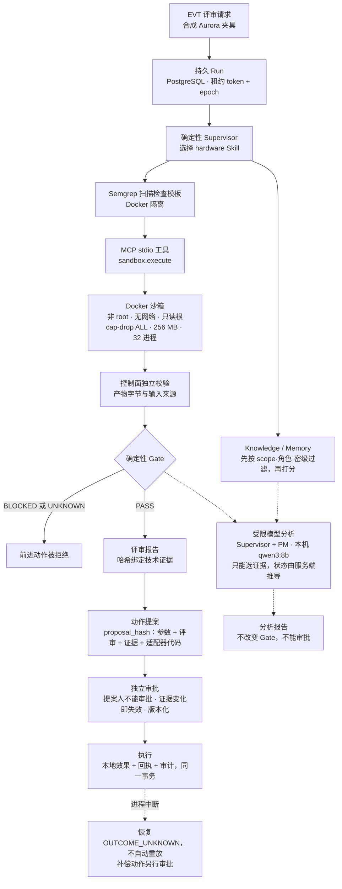

# ForgeFlow

**English summary.** ForgeFlow is a local, evidence-first prototype of the control plane an enterprise agent needs before it is allowed to act: durable runs with fenced leases, MCP tool calls into a locked-down Docker sandbox, permission filtering before retrieval, deterministic stage-gate rules, bounded local-LLM analysis whose output is data rather than authority, approvals bound to evidence hashes, and crash-safe action receipts. The scenario is a synthetic hardware EVT readiness review. Everything runs on one machine against synthetic data; it is not a production system and is not connected to real hardware, trackers or office tools. The rest of this page is in Chinese.

## 这是什么

ForgeFlow 是一个在本机运行的企业 Agent 运行时原型。演示场景是合成的硬件研发评审：项目 Aurora 能否从 Prototype 进入 EVT。它要回答的问题是：Agent 在企业里真正执行一个动作之前，系统必须保证什么。

- **运行可恢复。** 每次运行持久化在 PostgreSQL；worker 用带 token 和 epoch 的租约认领，过期的写入返回 `STALE_LEASE`；中断后无法确认结果的动作记为 `OUTCOME_UNKNOWN`，不会自动重放。
- **工具受隔离。** 检查程序先过 Semgrep 扫描，再通过官方 MCP Python SDK 的 stdio 工具 `sandbox.execute`，在非 root、无网络、只读根文件系统的 Docker 容器里运行。
- **检索先授权。** Knowledge 与 Memory 分开存放，都在打分之前按 scope、角色和密级过滤。
- **判定是确定性的。** Gate 规则给出 PASS、BLOCKED 或 UNKNOWN；证据过期、检查失败、产物校验不通过，都得不到 PASS。
- **模型受约束。** 本机 qwen3:8b 只读已有证据，只能从服务端给出的证据目录里选择；完成状态由服务端推导，模型不能改 Gate，也不能审批。
- **动作必须绑定审批。** 提案哈希绑定动作参数、评审报告、技术证据和执行适配器代码，批准和执行时各校验一次；提案人不能审批；效果、回执和审计在同一事务里写入。

所有研发数据都是合成的。没有生产部署，没有真实硬件认证，也没有接入 GitHub、Jira、飞书等外部系统。

## 当前状态（2026-10-10）

| 方面 | 状态 | 依据 |
|---|---|---|
| 默认测试（不需要 Docker、PostgreSQL、模型） | 1014 项：1001 通过，13 项实机测试默认跳过 | `pytest -q` |
| 与系统时钟无关 | 在 2026-10-09 的版本上，把系统时钟伪造为 2026-11-06、2027-06-01 各复跑一次，结果不变（到期提醒除外，见下文）；之后的改动没有重做这项验证 | [审阅与修复记录](docs/19-review-and-fix-record.md) |
| 冻结证据可重放 | S2C 实验的 26 个用例用锚定提交自己的代码重放 | `tests/test_frozen_replay_at_anchor.py` |
| 实机链路（Docker + PostgreSQL + MCP） | 2026-10-10 在 PostgreSQL 库副本上用当前代码重跑：真实 MCP 与 Docker 检查，本机 qwen3:8b 的 4 次分析放在同一个父 run 上，6 个动作经人工逐个批准后执行并补偿，提交前被杀后恢复，UNKNOWN 与超时被拒；失败和意外一并留档 | [`deliveries/2026-10-10/`](deliveries/2026-10-10/DELIVERY.md) |
| 本机模型分析（Ollama qwen3:8b） | 5 个真实模型场景各跑 1 次，共 20 次模型调用 | `deliveries/2026-10-06/s2c-fixes/evidence/` |
| 冻结评测 | 13 项验收：修正评分器的一个记录展开错误后，用同一批原始调用链重评为 13/13，没有新增模型调用；评测范围只是证据选择和服务端状态推导 | `deliveries/2026-10-06/s2c-fixes/evidence/regrade-01/summary.json` |
| 检索 | 只有词法检索：冻结评测集 37 个查询，macro Recall@5 = 78.38%（找到 29 个）；同义词和跨语言查询（各 4 个）全部漏检 | `preparation/s2/evaluation/RESULTS.md` |
| 多角色 | Supervisor 与 PM 使用模型；Architect、Android、SRE 是确定性检查器；Android 构建与设备测试未运行 | `analysis_workflow.py`、`domain_checks.py`、`sre_ops.py` |
| 身份 | 本地开发身份，静态 token；审批人身份来自测试身份文件，没有独立发放 | `api.py`、`fabric_runtime.py` |
| 外部系统 | Issue、阶段变更、Memory 只写本地数据库 | `fabric_store.py` |

各阶段的测试数量口径不同，不能相加。

## 架构



实线是一次评审的主链路。虚线是旁路：模型分析只读证据，结果不回流到 Gate 和审批；进程中断后进入恢复。

## 值得看的设计取舍

1. **模型输出是数据，不是权限。** 模型回复先过严格的 JSON 解析和结构校验，引用必须出现在服务端推导的证据目录里；伪造引用或越权字段（例如自报 Gate 状态、要求审批）直接拒绝，不重试。上下文 8,192 token、输出 800 token、temperature 0。见 `analysis_contracts.py`、`grounded_contracts.py`、`s2c_contracts.py`、`analysis_provider.py`。
2. **先授权，再检索。** `context.py` 在候选打分之前按 scope、角色、密级过滤；Knowledge 与 Memory 分开，候选 Memory 进入模型时标为 CANDIDATE；共享报告前重新校验来源权限。
3. **审批绑定证据，并且有版本。** `fabric_store.py` 的提案哈希绑定参数、评审哈希、技术证据哈希和适配器代码哈希，批准和执行时各重算一次。证据过期、评审失效或适配器代码升级时，旧提案标明失效原因（`EXPIRED`、`REVIEW_STALE`、`ADAPTER_CHANGED`），新版本追加写入，旧版本仍可读；审批人必须不同于这条审批任何一个版本的提案人。
4. **持久执行与围栏。** `store.py` 的租约带 token 和 epoch，过期写入被拒；幂等键防止重复提交；派发中断后状态为 `OUTCOME_UNKNOWN`，交给人处理，不自动重试。
5. **隔离失败即拒绝。** `sandbox.py`、`scanner.py`、`mcp_bridge.py` 只执行可信的固定模板，不执行模型生成的代码；Semgrep 未通过、源码哈希不符、容器清理失败都得不到 PASS；没有退回宿主机执行的路径；每个 MCP server 进程只服务一个 scope、角色和 run。
6. **时间是输入，不是环境。** Gate 和新鲜度检查显式接收当前时间；测试统一使用平移时钟（`tests/conftest.py`），并有检查防止代码直接读系统时间；夹具与 SOP 的到期有提醒测试和续期工具。
7. **证据可复现。** S2C 实验冻结了 50 个源文件的哈希。`freeze-git-anchor.json` 把冻结证据锚定到基线提交；重放测试用 `git archive` 导出该提交，用它自己的代码重跑固定的 26 个用例，并清除调用方继承的 pytest 选项。

## 运行

### 只跑测试

需要 Python 3.12 和 git。冻结重放会从锚定提交导出代码，所以要完整克隆（不要用 `--depth`，也不要下载 ZIP）。

```sh
git clone https://github.com/langju123456/forgeflow.git
cd forgeflow
python3.12 -m venv .venv
.venv/bin/pip install -r requirements.lock
.venv/bin/pip install --no-deps -e .
.venv/bin/python -m pytest -q
```

预期 `1001 passed, 13 skipped`。跳过的 13 项是实机测试：7 项需要 Docker 和 PostgreSQL（用 `FORGEFLOW_LIVE=1` 开启），6 项需要固定版本的 Semgrep 扫描镜像（设置 `FORGEFLOW_SCANNER_IMAGE`）。沙箱、扫描器和模型在默认测试里用测试驱动代替；`tests/test_mcp_bridge.py` 会启动真实的 MCP stdio 服务进程。

### 完整本地链路

需要 Docker（`python:3.12-slim`，以及用 `scripts/build_scanner.py` 构建的扫描镜像）、监听 `127.0.0.1:55436` 的 PostgreSQL 16（`scripts/bootstrap_database.py` 用生成的开发凭据初始化，凭据只写入被 git 忽略的 `.runtime/`），模型分析还需要 Ollama 和 `qwen3:8b`。这些步骤是按作者本机写的，最近一次完整运行在 2026-10-06，当前代码的复跑是下一步。

| 入口 | 作用 | 说明 |
|---|---|---|
| `python -m forgeflow.local` | 初始化本地库，提交 run，执行检查（Semgrep → MCP → Docker → Gate），查看结果 | [docs/07](docs/07-manual-demo-and-learning.md) |
| `python -m forgeflow.analysis_cli` | 本机模型分析：只读证据，不审批、不派发 | [docs/10](docs/10-local-model-demo.md) |
| `python -m forgeflow.evt_cli` | 创建和查看绑定评审，不做人工决定 | [docs/16](docs/16-evt-bound-contract.md) |
| `python -m forgeflow.fabric_cli` | 本地阶段、Issue、Memory 动作的提案、审批与执行（测试身份） | [docs/17](docs/17-fabric-local-contract.md) |
| `scripts/fabric_service.py` | 在 `127.0.0.1:8773` 启动本地 API | [docs/17](docs/17-fabric-local-contract.md) |
| `scripts/fabric_e2e.py checks` / `effects` / `crash-worker` | 实机端到端：检查、动作与补偿回执、中断恢复 | [docs/17](docs/17-fabric-local-contract.md) |
| `python -m forgeflow.sop_renewal` | 续期即将过期的 SOP 文档；默认只输出计划 | [docs/19](docs/19-review-and-fix-record.md) |

CLI 默认使用续期后的 `-v2` 夹具，`--legacy-fixtures` 才用原件。docs/07 里直接 `--decision APPROVED` 的旧步骤现在会被拒绝（`EVT_BOUND_APPROVAL_REQUIRED`），这是修复后的预期行为。

## 目录

| 路径 | 内容 |
|---|---|
| `src/forgeflow/` | 59 个模块，约 13,800 行 |
| `tests/` | 49 个测试文件，约 12,100 行 |
| `scripts/` | 服务启动、实机验证、评测与重评脚本 |
| `skills/` | 11 个 Agent Skill：说明文本与允许的工具分开，Markdown 不能授予权限 |
| `fixtures/` | 合成 Aurora 夹具；原件被冻结证据按哈希固定，`-v2` 是续期副本 |
| `scanner/` | Semgrep 扫描镜像与规则 |
| `docs/` | 设计评估、模块契约、威胁模型、验收矩阵（01–18），审阅与修复记录（19） |
| `deliveries/` | 按日期归档的交付说明、运行证据与审阅记录 |
| `preparation/` | 检索评测集与模型选择的准备材料 |

## 时间相关的行为

- `aurora-*-v2` 夹具的证据有效期到 2027-04-05。距到期不足 14 天（约 2027-03-22 起），`test_renewed_fixtures_do_not_expire_within_fourteen_days` 会失败，提醒续期：复制夹具、改 `valid_until`，并在 `fixture_family.py` 和 `contracts.RunRequest` 里登记新 ID。
- 原始夹具 `aurora-*` 已于 2026-11-05 过期。冻结证据按哈希固定了它们，所以原件不改。S2C 与 grounded 场景脚本按设计仍用原件，2026-11-05 之后重跑的结果会与归档证据不同；核对历史证据请用冻结重放。
- 已有数据库里的 SOP 文档 v1 也在 2026-11-05 过期。先在数据库副本上运行 `python -m forgeflow.sop_renewal --database-url <副本> ...` 看受影响的 run，再决定是否加 `--apply`。新版本写入后，引用 v1 的 run 会因 `SOURCE_CHANGED` 不能继续推进。

## 审阅发现与修复

主要实现完成后，独立审阅又确认了下面这些问题。每个修复都先提交一个在旧代码上失败的测试，再提交修复，并在另一个环境独立复跑。细节、确认方式和验证结果见 [审阅与修复记录](docs/19-review-and-fix-record.md)。

| 问题 | 修复 |
|---|---|
| 旧 CLI 和旧 HTTP 路由能直接批准“仅硬件”审批并派发动作，绕过 EVT 绑定评审 | 在 Store 层统一拦截并写审计事件 |
| 冻结实验按工作区校验源码哈希，任何后续修复都会让历史证据校验失败 | 锚定到基线提交，用该提交自己的代码重放 |
| 测试读真实时钟，夹具到期后全量测试会变红 | 统一的平移测试时钟，加防回归检查 |
| 适配器代码升级后，历史审批读不出，待批提案无法续批 | 追加式审批版本、失效原因、可审计的替代 |
| 续批后，早期版本的提案人仍能批准最新版本 | 审批人必须独立于这条审批所有版本的提案人 |
| 重评记录把执行时的代码和锚定源码混在一起 | 分开记录 |
| 冻结重放继承调用方的 pytest 选项，可能少跑用例 | 清除继承选项，要求固定用例集 |
| 演示夹具与 SOP 在 2026-11-05 过期 | `-v2` 夹具、单一夹具族、CLI 默认值、SOP 续期工具 |

## 公开历史

这个仓库的历史由原始开发仓库生成：与项目无关的个人规划材料（`sources/` 目录）已从所有提交中移除；冻结证据的锚点 `freeze-git-anchor.json` 随之指向改写后的基线提交（标签 `freeze-baseline`）。发布前还做了一步脱敏：本机绝对路径改为 `/path/to/forgeflow`，测试报告里的主机名改为 `localhost`，与本项目无关的私人项目盘点和个人材料引用已删除或改写，提交作者邮箱改为 GitHub 隐私邮箱；被改动文件在各清单、封存记录里登记的 SHA-256 同步重算，所以仓库内的封存校验仍然自洽，但这些哈希与原始开发仓库不同。提交时间不变。`deliveries/2026-10-07/` 等审阅记录里引用的提交号属于原始历史，按提交说明和时间可以一一对应。第一步的生成脚本是 `scripts/publish_public_history.sh`；脱敏一步的词表含私人信息，不随仓库公开。

## 许可

尚未选择开源许可证。第三方组件与许可证见 [docs/THIRD_PARTY.md](docs/THIRD_PARTY.md)。
