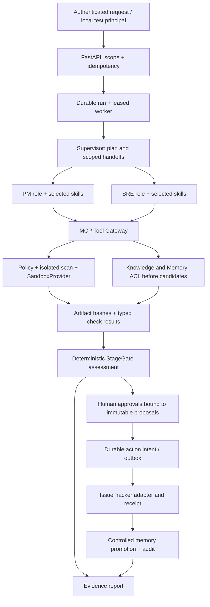

# 总设计评估

状态：原设计已落实为首条本地实现；设计阶段快照保留于当日 docs 归档。实际 S1 状态见 DELIVERY、04 验收矩阵与 08 Runtime 契约；最终需求以两版方案为依据。

## 结论

ForgeFlow 的技术方向可行，价值在于同一请求中把知识、职责、执行权限、证据、批准和实际行动绑定起来。八小时实现全部功能并完成安全、恢复、LLM 与集成验收的原估计缺少依据。争取 Oct 6 得到真实可运行链路合理；承诺所有最终模块一夜成熟不合理。最终范围保留，通过有依赖的阶段交付，阶段未通过不挂完成标签。

首条 Aurora 链路保留两个执行模式：当前确定性编排验证持久状态和安全，实际执行职责为 hardware；授权模型接入后，相同工具/权限/状态契约驱动真实 Supervisor + PM/SRE。前一种不能称为 LLM Multi-Agent。后续添加架构、Android、硬件角色必须有独立 SOP、实际分派与证据贡献，不能靠创建同名类或五个 prompt 文件宣称完成。P2新增RELEASE终态一并保留，不因首链EVT而删掉最终范围。

## 对原方案的修正

| 原建议或冲突 | 评审决定 |
|---|---|
| V1 检索图画成 RRF → ACL；V1 安全章节和 V2 又要求先 ACL | 从候选数据选择开始实施 ACL/classification；所有检索通道、缓存、引用解析、扩展上下文和统计都受相同 scope 约束。 |
| “已有项目有 BM25/RRF，可快速迁移 hybrid” | 已证实是 FTS5 BM25 + exact/alias 的 RRF。不是 embedding/vector hybrid；向量通道与企业权限须新做。 |
| security 在第七阶段才做深 | 身份、权限、scope、approval、审计、限额从第一个 schema 与调用链就存在；之后做强化。 |
| HIGH → approval 可能被解读为任何危险操作可批准 | DENY 不可通过普通批准变 ALLOW。权限不足、跨租户、socket/secret 挂载、任意 host path 等直接拒绝。 |
| “Semgrep 后代码安全” | scanner 是辅助信号，no findings 不是安全证明；扫描错误/超时不能跳过为 pass。 |
| Gateway 只是三个 Python function | 跨进程真实 MCP client/server 与协议测试；函数调用只属于 server 内部业务实现。 |
| Human Approval 与 EVT pass 混在一起 | 区分技术评估、项目阶段转换批准、Issue/通知副作用批准、实际执行回执。Issue 创建批准不等于准入 EVT。 |
| Supervisor 能调用全部 role 工具 | Supervisor 仅分派与读取授权报告；role 不继承 Supervisor 全权，数据由 role 身份重检索。 |
| 8 小时五角色、3–7 天企业级 | 仅作为历史建议，不作为工期承诺。见 06 中依赖和估计。 |
| 网络 allowlist 是 Docker 一行配置 | Docker network none 先做；allowlist 要独立 egress enforcement，不能靠 DNS/字符串正则。需要额外批准与测试。 |
| gVisor 可直接在 Mac 升级 | 官方要求 Linux；本机未验 runsc，设计 Provider 边界但不虚写已支持。 |
| 原文 GitHub Issue/飞书群作为 demo 必做 | 完整目标仍包含真实 DevOps 与办公集成；本地适配器不算该项验收。外部目标/身份/内容/权限批准前保持待接入。 |

## 同一执行链

这张图描述最终执行边界。当前贯通 hardware 固定模板和本地 Issue 链；PM/SRE 实际分派、模型、外部 adapter、全部工具 MCP 化仍待实现。StageGate 先产出可审查 assessment；之后批准与 action receipt 更新报告事实，而不是重新写成“LLM 认为 pass”。没有 blocker 也不能自动跳过技术证据和 stage approval。

## 数据与部署边界

初期单机、独立 workspace、自有 FastAPI/Python 包与数据库。不要连接其他现有项目的数据库，不复用其运行端口、挂载、凭据或部署。只用两个合成 tenant 的研发资料、合成代码/日志、合成 hardware evidence；把 SYNTHETIC 标签保留到 report 与 artifacts。

推荐新项目直接用 PostgreSQL + SQLAlchemy 持久化（已使用独立 PostgreSQL 16 与非 superuser 应用账号实跑，尚无 pgvector）。先用 exact vector search 保证权限候选集合清晰，再依数据量需要引入分租户 ANN；pgvector extension/embedding model 的供应、许可和版本还需在实施前锁定。SQLite 可作为另选的单 worker 核心验证方案，但不会算成 PostgreSQL/pgvector 验收，不能替换用户最终要求。

Control plane 可以管理 Docker daemon；sandbox 内没有 daemon socket、host home、数据库、密钥或控制面 API。工具执行与 model provider 网络完全分离，model 只收到经 classification 允许的内容。只读 rootfs 与 namespace/cgroup 是容器约束，不是内核漏洞隔离保证。

## 真实 LLM 接入最小决定

需要确定：provider / exact model、base URL、授权调用方式、费用上限、可发送数据级别、每 run 的 token/tool/time budget、是否支持工具调用与结构化输出。用户不需要提供密钥给模型上下文；通过批准的 secret 注入控制面进程，禁止自动读取个人 `.env`/Keychain。现有开发工具插件权限不等于 ForgeFlow Runtime 持有可用模型/connector 凭据。

可选择经确认已运行的本地 endpoint，或用户授权的 API；不默认购买 GPU，不下载大模型，不拿其他项目密钥。模型不可用时，只交付并标明确定性执行链证据，LLM 项保持未验收，不把固定 JSON/预录输出描述为模型运行。

## 业务真实性

EVT/DVT/PVT 规则是教学用合成研发规则，来源记为 `aurora-synthetic-sop`，版本/哈希固定。Android 编译与硬件实验报告只有执行/外部原始证据存在时才是真实业务能力；Python checker 检查合成 firmware manifest 只能证明 Gate 框架。项目不能替代硬件认证、真实 NPI 流程或 WorkBuddy/Dify/Coze 二开。

## 设计 review 的判断

采用“薄而完整的业务链 + 从首阶段贯穿的安全与持久性”，同时保留所有最终角色、NPI 阶段、向量与办公集成的独立验收。拒绝平均造空壳模块；拒绝用 local adapter 冒充 GitHub/飞书，或用无模型编排冒充 Multi-Agent。本设计不建议提前部署。
