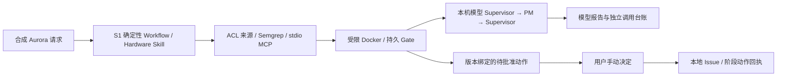

# S2A 本机模型分析：运行、阅读与练习

本页是 Oct6 新增入口。Oct5 的 S1 和 S2 准备封存保留原样，历史文档中“没有模型调用”描述的是当时状态。最新真实运行结果以 `deliveries/2026-10-06/DELIVERY.md` 和该目录证据为准。

## 当前链路与边界

同一合成 Aurora 请求先通过原 S1 确定性 worker、Semgrep、真实独立 stdio MCP 和 Docker 检查，保存 Gate。S2A 在该 run 的授权证据上进行四次真实本机调用：Supervisor 规划 → PM 提议最多两个检索 → 实际 Knowledge/Memory 服务检索 → PM 报告 → Supervisor 汇总。这里 Knowledge/Memory 是 `IN_PROCESS` 服务，模型调用是 Ollama HTTP；只有 S1 的 sandbox.execute 是 MCP。

分析不修改原 run 的 Gate、审批、项目阶段、Issue 或 Memory。`analysis.state=COMPLETE` 表示分析链完成；硬件 Gate 可以仍为 BLOCKED 或 UNKNOWN，人工决定和实际执行回执分别保留。模型报告有引用与权限验证，但自由文本的语义真实性仍需审阅，不能把 schema/citation 验证当作结论证明。



S2A 模型没有接管 S1 硬件检查调度，也没有把模型报告加入原批准材料；后续若改变批准依据，须另立 proposal 版本和验收，不能悄悄复用旧批准。

唯一开发原件：`/path/to/forgeflow`。Python3.12/依赖、专属 PostgreSQL16、Docker 和本机 Ollama/qwen3:8b 在该机器已准备；不读取私人 API 密钥、不下载新模型、不使用云端回退。

## 先看现有结果，再手动创建新请求

```sh
cd /path/to/forgeflow
.venv/bin/python -m forgeflow.analysis_cli preflight
.venv/bin/python -m forgeflow.analysis_cli demo --fixture pass --key my-aurora-pass-01
.venv/bin/python -m forgeflow.analysis_cli demo --fixture blocked --key my-aurora-blocked-01
.venv/bin/python -m forgeflow.analysis_cli demo --fixture unknown --key my-aurora-unknown-01
```

这些命令会持久创建本地合成 run、执行固定检查并调用模型，不会代替用户批准。重复相同 key/fixture 应读取同一 run/analysis，模型调用数量不增加；改变 fixture 使用同 key 应拒绝。新逻辑版本或新的实际请求使用新 key，失败尝试保留。

输出中保存的 analysis id 可用于读取和取消：

```sh
.venv/bin/python -m forgeflow.analysis_cli show <analysis_id>
.venv/bin/python -m forgeflow.analysis_cli events <analysis_id>
.venv/bin/python -m forgeflow.analysis_cli cancel <analysis_id>
.venv/bin/python -m forgeflow.analysis_cli recover <analysis_id>
```

取消/超时不证明远端生成已停止；若结果未知，持久 profile 槽和预算继续占用，后续实例不得再次发起生成。`recover` 不能把未知请求自动变成可重试。当前没有后台“自动恢复”或远端请求级停止证明。

## API 与手动批准

```sh
.venv/bin/python -m forgeflow.analysis_api
```

服务固定 `127.0.0.1:8769`，Swagger 为 `/docs`，分析配置状态为 `/analysis/health`。原 `/health` 保留 S1 历史能力声明。新增 `POST /analyses` 接收 `{scope, run_id}` 与 `Idempotency-Key`，查询/events/cancel 仍受可信本地身份和完整 scope 授权。正文不能提交角色、模型地址、凭据或批准权限。

若要让开发服务脱离当前终端，使用 `.venv/bin/python scripts/start_analysis_api.py`。它只启动该服务，日志和 PID 放本工程 `.runtime/`，不停止已监听8769的其他进程。代码版本改变后应重启自己启动的服务；旧进程不会自动加载新模块。

DEV token 只在该工程 `.runtime/identities.json` 的本地任务生成配置中使用，不复制到交接包或报告。检查结果等待批准后，用户可按 `docs/07-manual-demo-and-learning.md` 的 `decide`/`dispatch` 逐项手动操作本地模拟 IssueTracker；每次批准绑定 proposal_hash 和最新 run revision。分析阶段没有替用户做这一步。

## 预算、出处与限制

固定 qwen3:8b digest 在调用前后通过 Ollama 元数据检查；这依赖可信本机 daemon，不是请求级密码学模型证明。`think=false`，上下文8192、单次输出800、最多四次调用、单次60秒、整链180秒、并发一、不自动重试。消息与 schema 的 UTF-8 字节数加固定余量用于3500输入 token 的保守上界；实际 token 用量另存，不冒称使用精确 tokenizer。超界或无明确完成证明均停止。

输入仅限精确授权的合成 Aurora fixture、SOP版本及其派生候选 Memory；caller 与角色 ACL 在正文加载和排序前取交集，分享和发表时在同一数据库事务重核来源、版本、hash、时效和授权。模型只有服务器提供的 opaque refs；它不能用新角色、URL、工具名或引用扩大授权。候选 Memory 不自动升级为事实。

## 本人可完成的修改练习

1. 阅读一次真实 trace，逐个解释四次调用、实际检索收据、原 Gate、pending approval 与零 action receipt。
2. 重复同一 key，在调用台账中确认没有新增 call；再换 fixture 保留该 key，解释拒绝原因。
3. 在独立练习分支/副本缩短 PM 报告长度限制，运行对应测试，观察合法长度和超界如何分开；不要改旧封存或删除失败证据。
4. 运行跨租户、撤权、伪引用、HTTP500结果未知的 TEST_DRIVER 测试，解释其覆盖范围，以及为什么这些测试不等于真实模型质量测评。

能手动复现、解释和修改这些点可作为学习进展，不据此声称已掌握所有 ML、多 Agent、硬件流程或生产安全能力。pgvector/embedding、SRE与完整五角色/NPI、外部 DevOps/办公适配、生产身份/RLS和部署仍是后续阶段。
