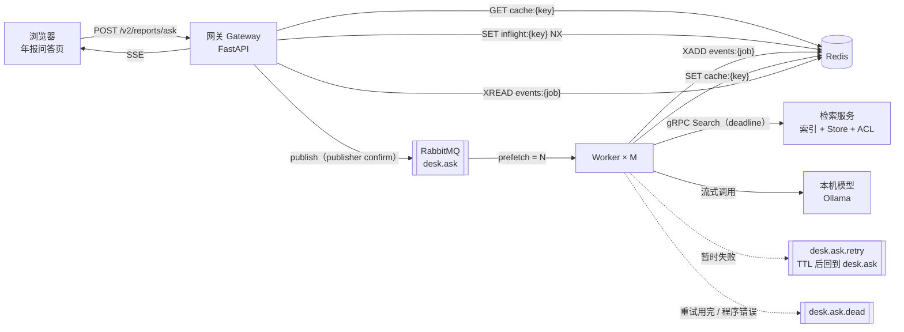
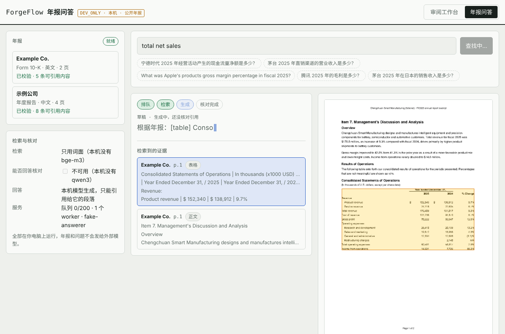
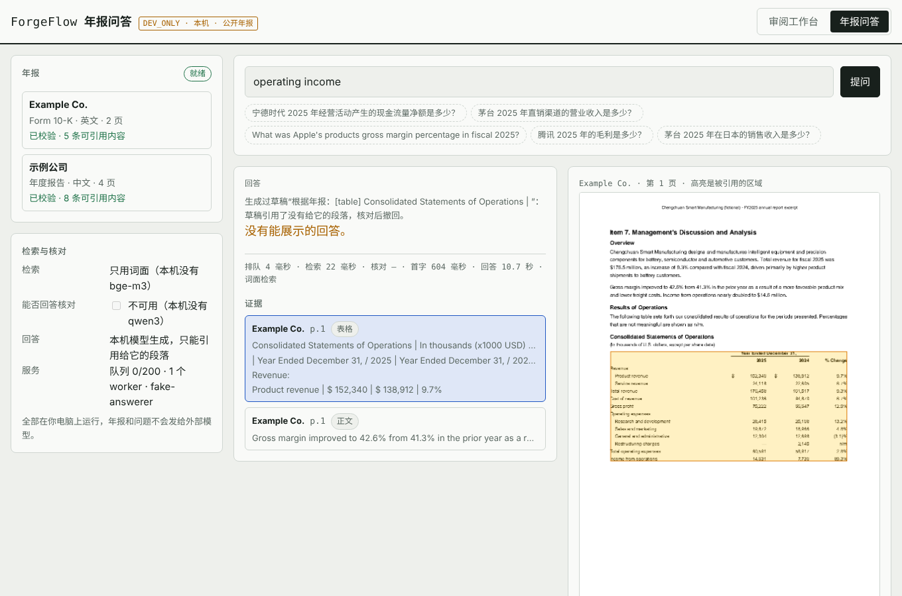

# 20 年报问答服务化：Redis + RabbitMQ + gRPC + SSE

`forgeflow.desk_service` 把原来的单进程年报问答（`report_desk.py`：在一个 HTTP 请求里同步做完检索、可回答性判断、回答）拆成可以并发服务的几个进程。检索、判断、回答的逻辑一行没改，改的是“请求怎么排队、谁来做、结果怎么回到页面、出错怎么办”。DEV_ONLY：只绑 127.0.0.1，一个固定的分析员身份。

## 解决什么问题

单进程版本在真实年报上一次回答的端到端时延中位数是 21.8 秒（`preparation/s4/real-reports/RESULTS.md`）。直接放在 HTTP 请求里同步做，有这些问题：

| 问题 | 单进程版本的表现 | 服务化之后 |
|---|---|---|
| 用户等待 | 20 多秒什么都看不到，最后一次性出结果 | 页面按阶段更新：排队 → 检索 → 生成；回答逐段出现（草稿），核对完再替换成正式回答 |
| 重复的问题 | 每次都重新检索、重新调模型 | Redis 缓存：同一身份、同一索引、同样设置的同一个问题，第二次不调模型 |
| 同时问同一个问题 | 每个请求各调一次模型 | 合并（join）：只建一个任务，其余请求读同一个事件流 |
| 并发压到模型上 | 请求有多少，模型就同时收多少 | RabbitMQ 的 prefetch 限定每个 worker 同时只做 N 个；多出来的在队列里排着，能看到队列长度 |
| 进程中途死掉 | 请求失败，前面的计算白做 | 消息没确认（ack），RabbitMQ 交给另一个 worker 重做 |
| 依赖临时不可用 | 直接报错 | 进重试队列，延迟后再试；超过次数进死信队列，页面收到明确的错误 |
| 请求太多 | 全部接下，越来越慢 | 队列满了网关返回 429 和 Retry-After |

## 结构



一个问题的完整路径（`queued` 等是事件流里的事件类型）：

1. 网关算缓存键，查 `cache:{key}`。命中：直接写一条 `final` 事件，返回 `state: cached`。
2. 没命中：`SET inflight:{key} {job_id} NX`。设置失败说明同一个问题正在做，返回那个任务的 id（`state: joined`）。
3. 设置成功：建任务记录，写 `queued` 事件，把任务发到 `desk.ask`（持久化消息，等 broker 确认）。返回 202。
4. 浏览器打开 `GET /v2/jobs/{id}/events`（SSE），网关从 Redis Stream 读事件推给浏览器。
5. Worker 取到任务：写 `started`；gRPC 调检索服务拿证据，写 `retrieved`；流式调模型，回答文字每 80 毫秒合并成一条 `token` 事件；整段输出交给 `cited_answer` 原有的核对；写缓存、任务记录、`final` 事件；释放 `inflight`；最后才 ack。

## 每一层为什么存在，不做会怎么坏

### RabbitMQ：工作队列

- **作用。** 把“接收请求”和“做回答”分开。网关只负责收和回，回答慢不会占住网关。
- **prefetch。** 一个 worker 最多同时持有 N 条没 ack 的消息，也就是最多同时跑 N 个模型调用。本机模型能并行处理的请求很少，多出来的请求只会在模型服务器内部排队，那里看不到、也取消不了；放在 RabbitMQ 里排队，队列长度是看得见的（`GET /v2/reports` 里的 `queue.waiting`）。
- **ack 放在最后。** 结果写进缓存、任务记录写成 `done`、`final` 事件写出之后才 ack。在这之前 worker 被杀（SIGKILL），连接一断，RabbitMQ 把消息交给别的 worker。这叫至少一次投递（at-least-once）：同一个任务可能被处理两次，所以每一步都要能重复执行（见下面“幂等”）。
- **重试不用 sleep。** 暂时性失败时，worker 把任务发到 `desk.ask.retry` 然后 ack。这个队列设了消息 TTL 和死信目标 `desk.ask`，TTL 到了消息自动回到主队列。worker 不会因为等待重试而占着 prefetch 名额。
- **死信队列。** 重试次数用完（`max_attempts`），或者 worker 代码本身出错，任务进 `desk.ask.dead`，留给人看，不会无限重试。
- **背压（backpressure）。** 主队列设 `x-max-length` 和 `x-overflow: reject-publish`。队列满了，broker 对发布返回 nack；网关开着 publisher confirms，收到 nack 就返回 429，同时撤掉 `inflight` 标记。不做的话，请求会无限堆积，每个人等的时间都越来越长。

### Redis：缓存、合并、任务状态、事件流

- **缓存键包含什么。** 提问者身份、索引版本、回答模型、`cited_answer` 的提示词哈希、是否开判断、top_k、问题（只去掉多余空白）。
  - 身份：检索在打分之前就按角色过滤，不同身份可能检索到不同的段落。键里没有身份，一个人的回答会被另一个人读到。
  - 索引版本：`ReportDesk.index_version()` 是所有行的内容哈希加检索模式。重新导入年报，或者从词面检索换成混合检索，旧答案自动失效。
  - 只缓存确定的结果（`ANSWERED`、`NOT_FOUND`、`NO_HITS`、`UNSUPPORTED`）；`ANSWER_ERROR` 不缓存。
- **合并用 `SET NX`。** “查有没有、没有就建”如果分两步做，两个同时到的请求都会看到“没有”，各建一个任务。`SET ... NX` 在 Redis 里是一个原子操作，只有一个请求能设置成功。释放时用 Lua 脚本“值等于自己的 job_id 才删”，避免删掉后来别的任务设置的键。
- **事件为什么放 Redis Stream，不放 RabbitMQ。** 队列里的消息被消费一次就没了；事件需要被多个读者从任意位置重读：发起请求的页面、合并进来的第二个页面、断线重连的页面。Stream 里每条事件有 id，SSE 把它作为 `id:` 发给浏览器，EventSource 重连时自动带上 `Last-Event-ID`，网关从那个位置之后继续读。事件流和任务记录都设了过期时间。

### gRPC：检索服务

- **为什么单独一个进程。** 检索要先加载索引：解析 700 多页 PDF、建 Store、给每一行算 bge-m3 向量并放在内存里。只在检索服务里做一次；worker 不持有索引，启动快，可以随时加减。
- **为什么用 gRPC。** 服务之间的接口在 `desk.proto` 里有类型定义；每次调用带截止时间（deadline），worker 放弃等待时调用会被取消；状态码能区分“暂时不可用”和“请求本身有问题”。
- **身份放在 metadata 里。** worker 只传主体 id（`x-forgeflow-subject`），不传角色；检索服务按自己的表把主体映射成 Principal，未知主体返回 `PERMISSION_DENIED`。worker 没法通过多报角色扩大能看到的内容。
- **`wait_for_ready`。** 检索服务重启的几百毫秒里，worker 的调用会等它恢复（不超过截止时间），而不是立刻失败；超过截止时间的中断变成 `DEADLINE_EXCEEDED`，按暂时性失败重试。客户端的重连退避调成 0.2 秒起步（gRPC 默认 1 秒起步并逐次变长）。
- **状态码怎么分类。** `UNAVAILABLE`、`DEADLINE_EXCEEDED`、`RESOURCE_EXHAUSTED` 是暂时性的，重试；`INVALID_ARGUMENT`、`PERMISSION_DENIED` 是最终的，不重试。

### SSE：流式输出

- **为什么不用 WebSocket。** 这里只有服务器到浏览器一个方向；SSE 是普通 HTTP，浏览器自带断线重连和 `Last-Event-ID`。
- **草稿不是回答。** 模型输出的是严格 JSON，`AnswerFieldExtractor` 在流式输出里找到 `"answer"` 字段，把它的文字边解码边推出去（处理被切开的转义，例如一个 chunk 以 `\` 结尾）。引用核对只能在整段输出完成后做，所以页面上的草稿是灰色、标“还没核对引用”；`final` 事件到了就替换。核对不通过（例如引用了没给它的段落），草稿会被撤回，页面写明原因（截图二）。
- **合并 token。** 每 80 毫秒最多写一条 `token` 事件，避免每个 token 一次 Redis 写入。

### 幂等：同一个任务被处理两次也没问题

| 情况 | 处理 |
|---|---|
| 任务已经 `done` 或 `failed` 又收到一次 | 直接 ack，不做 |
| worker 在 ack 前死了，任务被重新投递 | `deliveries` 计数加一，事件里 `attempt` 变成 2；先查缓存（前一个 worker 可能已经算完），没有再从头做 |
| 页面收到第二个 `started` | 清掉上一次的草稿重新显示 |
| 任务入队时的索引版本和实际检索用的不同 | 按实际版本算缓存键写入 |
| worker 的模型或提示词和任务登记的不一样 | 不处理，进死信队列（`CONFIG_MISMATCH`），避免把一个模型的答案写到另一个模型的缓存键下 |

## 怎么运行

```bash
.venv/bin/pip install -e '.[pdf,service]'
(cd web && npm ci && npm run build)
bash scripts/desk_service.sh        # Docker 起 Redis 和 RabbitMQ，再起检索服务、2 个 worker、网关
# 打开 http://127.0.0.1:8790/ ；RabbitMQ 管理页 http://127.0.0.1:15672 （guest/guest）
```

回答模型默认是 `forgeflow-qwen3-8b-ctx16k`（`scripts/mac_real_reports_eval.sh` 会创建），可以用 `--model` 或 `FORGEFLOW_DESK_MODEL` 换；所有配置项见 `desk_service/config.py`，环境变量前缀 `FORGEFLOW_DESK_`。





## 测试

| 文件 | 内容 | 需要 |
|---|---|---|
| `tests/test_desk_service_unit.py` | 缓存键随每个影响答案的因素变化；草稿提取在任意位置切开都解码正确；SSE 帧格式；流式客户端的请求参数与三类失败 | 无 |
| `tests/test_desk_grpc.py` | gRPC 返回的证据与进程内 `ReportDesk.evidence` 完全相同；身份只从 metadata 来；加载中返回 `UNAVAILABLE`；参数错误返回 `INVALID_ARGUMENT`；页面图片 | 无 |
| `tests/test_desk_service_live.py` | 15 项端到端：阶段与草稿、断线续读、缓存、合并、无证据不调模型、草稿撤回、坏输出不缓存、模型恢复后完成、重试用完进死信、检索服务短暂重启被等过去、超过截止时间的中断被重试、worker 被 SIGKILL 后任务由另一个 worker 完成、队列满返回 429、索引未就绪返回 503、队列与 worker 数 | 本机 Redis 和 RabbitMQ，`FORGEFLOW_SERVICE_LIVE=1` |

端到端测试和压测里的模型是替身（`desk_service/testing.py`）：它按设定的速度流式返回一个确定的回答，可以模拟宕机、截断、乱码、乱引用。用它测的是服务层的行为，不代表回答质量。压测结果见 `preparation/s5/desk-service/RESULTS.md`。

## 限制

- 一个固定的开发身份；没有真正的认证。
- 检索服务是单实例；它挂了，worker 等到截止时间后进重试，重试用完任务失败。多实例要在 gRPC 客户端做负载均衡，并保证各实例的索引版本一致。
- Redis 没开持久化：重启后缓存和进行中的任务记录都会丢；RabbitMQ 里的持久化消息不丢，worker 会重新处理它们。
- 网关在 `SET NX` 之后、发布成功之前崩溃，`inflight` 标记会留到过期（`job_ttl_s`，默认 1 小时）；这段时间里同一个问题会合并到一个永远不会被处理的任务上，读者等到 SSE 的最长时长才断开。修法是给合并加一个“任务排队超过 N 秒仍是 queued 就重新发布”的检查，还没做。
- 真实模型只跑过一次冒烟运行（1 个 worker，见 `preparation/s5/desk-service/RESULTS.md`）：等待主要花在 prefill（首字前占 68%–91%），流式输出只缩短最后几秒；多 worker 下的吞吐没测。
