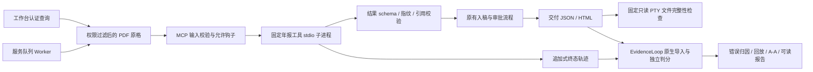

# Manus 模块的真实产品接入

## 架构与职责



- `report_plugin.py`：从 Manus Q3 借鉴任务拥有 MCP 会话、调用前拦截、进程故障后丢弃会话的模式。只暴露 `annual_report.answer.v1`，并在子进程内完成 CATL 年度原格与 Apple 服务收入计算。不是任意插件安装器。
- `report_desk.py` 与 `desk_service/worker.py`：正常 API 和异步 worker 使用同一运行时。任务结束由应用生命周期关闭子进程；超时或崩溃记录 unknown，协议错误记录 failure；失败不变成业务上的“未找到”。
- `report_trace.py`：输入、原始行指纹、调用与结果、终态保存在本地追加式 JSONL。文件锁与 fsync 保护追加；成功轨迹随原有审批摘要进入导出。
- `research_api.py`：在入稿前校验结果与 trace、工具版本、输入/输出指纹、引用行版本和页码。沿用已有作者、审阅人和交付机制。
- `pty_capture.py`：从 Manus Q5 借鉴绝对字节游标、UTF-8 边界、有限缓冲和 PTY 生命周期，只执行固定的导出完整性检查器。超时清理进程组并回收进程，校验失败返回非零退出码。它不执行用户 shell，也不替代数值与审批核验。

## 使用与验收边界

认证后的原有 `/reports/ask` 对两类受支持问题自动走 MCP，无需额外命令。其他问答保留原有路径。服务版也走同一 MCP 工具；未完成或错误任务不能获得入稿许可。

```bash
PYTHONPATH=src python -m forgeflow.pty_capture /path/to/research-export.json
```

`scope=artifact_integrity_only` 明确限定 PTY 的判断范围。EvidenceLoop 另行读取导出，独立复算年度金额、期间、单位、增速和贡献，并核对交付记录。缺证据为 unknown，冲突和错误为 fail，不能用工具自己的成功日志代替判断。

本轮真实本机验收使用原始 CATL 2025 年报和 Apple FY2025 10-K；两个身份由脚本扮演，不能表述为真实用户试用。两题均为固定公开开发题，不代表开放任务准确率、模型训练收益或生产吞吐。模型调用数为零。原始 Manus 八题目录保持不动；这里只移植并适配了上述模块，未移植七个任意终端工具或整套 Watchtower UI。

验证命令：

```bash
PYTHONPATH=src python -m pytest -q tests/test_report_plugin.py tests/test_pty_capture.py tests/test_research_review.py tests/test_annual_cash.py
PYTHONPATH=src python -m pytest -q
```

测试包括真实 MCP 会话复用、启动/调用超时、进程崩溃、调用取消与下一次恢复，错误输出和拒绝输入不生成许可，以及 PTY 游标、溢出、UTF-8、非零退出与进程回收。合成故障与真实 PDF 流程分别记录。
