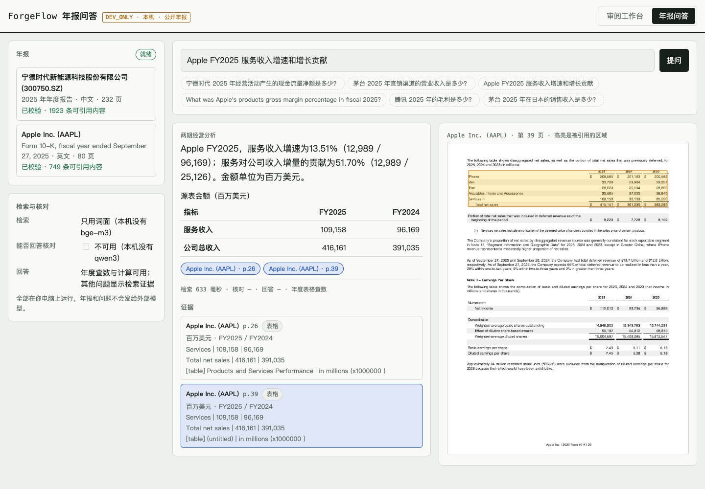

# 分析师怎样区分收入增速与对总增长的贡献

主讲任务由“服务收入增长多少”改成“它解释了公司增量的多少”。以 Apple FY2025 年报为第二个公开开发文档。推荐者为 Codex；未进行独立用户试用。

|做法|用户如何使用|选择依据|
|---|---|---|
|1. 摘录披露的 Change 百分比|查表即可得到约数|披露增速不能回答贡献。对照实跑。|
|2. 用当年服务收入除以当年总收入|得到收入占比|回答结构份额，不能代替增量份额。对照实跑。|
|3. 绑定两种公式与四个原格|可同时复算增速和增量贡献|覆盖口径改动；需要两年分部和总额。对照实跑。|
|4. 直接让生成模型选分母|自然语言最灵活|可能选错口径；增加生成成本。|
|5. 让模型编写 Python 公式|能处理未预设的任务|代码审阅与资源隔离成本较高。|
|6. 给分析师自行编辑 Excel|熟悉且可独立复算|引文、修订关系和历史难统一。|
|7. 图表解释分子分母|直观看到分部抵消|图表仍依赖正确事实与公式。|
|8. 先显示不同问题供点击选择|适合真正含糊的指令|已经指定的任务不必再确认。|
|9. 让两个 Agent 分别计算再裁决|能观察路径分歧|额外生成开销，两个 Agent 可能选同一错分母。|
|10. 由结构化申报服务交叉核对|提供另一种事实来源|必须对齐概念、财年和重述版本。|

三种执行策略共享同一张冻结的真实年报表、同一组输入、同一币种与单位、同一精度，均不调用模型。实验记录原始输出；评价由独立评测端负责。

## 已运行的结果

本地脚本 `scripts/apple_sales_dev.py ~/code/finreports <输出文件>` 校验官方 PDF 哈希并重新解析入临时 SQLite。真实 HTTP handler 通过 FastAPI TestClient 调用，证据为 PDF 页 26 和 39；页号指 PDF 序号。无模型和付费调用。每次调用的 ID、输入、原表、公式、摘要和耗时见[开发运行记录](apple-sales-dev.json)。

|策略|FY2025 实际输出|回答的业务问题|
|---|---:|---|
|读取服务行披露的 Change|14%|服务收入同比增速，按原表整数精度|
|服务收入除以当年公司总收入|26.23%|服务在当年收入中的占比|
|分别绑定两期四个原格|增速 13.51%，贡献 51.70%|同一增量 12,989 百万美元，分母分别为上年服务收入 96,169、公司收入增量 25,126|

Codex 推荐第三种作为可复算计算工具。2024 年同样执行，贡献为 141.54%；产品保留大于 100% 的合法结果。2023 缺少可用的 2022 对比列，返回待核。测试覆盖零分母、负增量和不同规模分母。披露的 14% 是合法的舍入值；在客户只想核对原表口径时，第一种仍有价值。单一公开报告不支持推广到所有分部或币种。

浏览器实操使用真实工作台、经哈希核验的本地公开 PDF、原解析缓存及本地 SQLite；选择 FY2025 例题，读取两种比率与四个原格，点击第 39 页并确认图片加载，再切换回宁德全年问题。它是 Codex 代行的本地交互检查。截图中的源页高亮为整表。观察到旧界面在没有模型时仍说“只显示证据”，本轮已改成说明年度查数和计算仍可使用。
